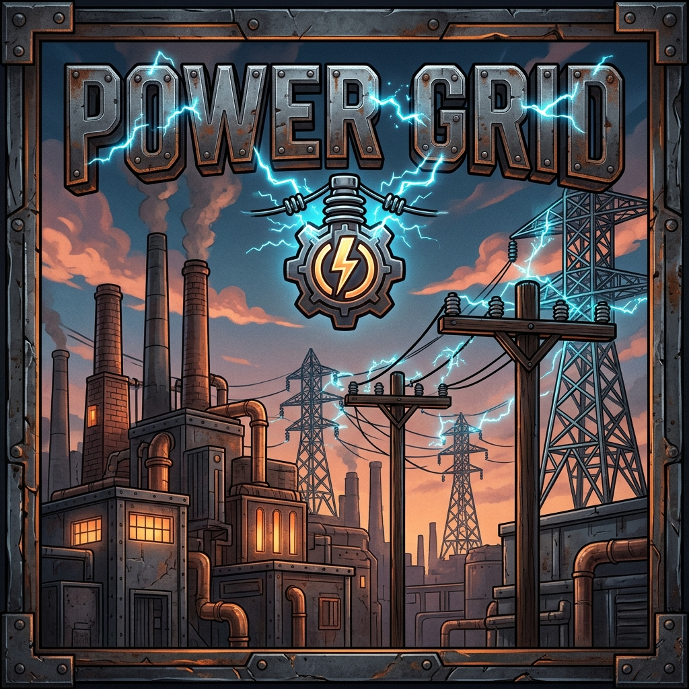

# CurseForge Upload Template & Metadata Guide: Power Grid

This document contains everything needed to publish and update **Power Grid** on CurseForge. You can copy-paste each section directly into the CurseForge Project Creation and File Upload forms.

---

## 1. CurseForge Project Submission Fields

### Project Name
`Power Grid`

### Short Summary / Tagline (Max 255 characters)
> Heavy industrial electricity distribution, overhead power poles, high-voltage transmission lines, and substations for modern Minecraft!

### Primary Category
- **Technology**

### Secondary Categories
- **Energy, Fluid, and Item Transport**
- **Processing**
- **Automation**

---

## 2. Project Description (Markdown / Rich Text)
*(Copy everything below this line into the "Description" box on CurseForge)*

---

# ⚡ Power Grid
**Heavy Overhead Electricity Distribution • High-Voltage Catenary Wires • Substations • Industrial Energy Transport**

*Built natively for Minecraft 26.3 on NeoForge.*

---

## 🔌 Overview
**Power Grid** brings authentic electrical engineering back to Minecraft, deeply inspired by the beloved mechanics of *Immersive Engineering*. Say goodbye to invisible magical power cables buried underground — **Power Grid** requires you to plan, run, and maintain real overhead transmission lines across poles, towers, substations, and factories!

From running early copper Low-Voltage lines to your first workshop machines, to stepping up power with Substation Transformers and stringing heavy steel-core High-Voltage cables across entire mountain ranges to heavy industrial factories and substations, Power Grid makes power transmission visually spectacular and engineeringly rewarding.

---

## ⚡ Core Features

### 1. Three-Tier Voltage Grid Architecture
- **Low Voltage (LV)**: 400 FE/t throughput, 16-block maximum span. Crafted from copper. Ideal for local workshops, lighting, and standalone machines.
- **Medium Voltage (MV)**: 2,048 FE/t throughput, 32-block maximum span. Crafted from electrum. Perfect for factory sub-mains and midgame industrial machinery.
- **High Voltage (HV)**: 16,384 FE/t throughput, 64-block maximum span. Heavy steel-core cables engineered for long-distance cross-country grid transmission.

### 2. Distance Resistance & Transmission Losses
- Just like real-world power grids, longer wire spans encounter electrical resistance.
- Low voltage suffers a 2.0% loss per block, making regional runs inefficient.
- High voltage lines feature only 0.5% loss per block, incentivizing engineers to construct realistic regional substations with step-up transformers!

### 3. Utility Poles & Transmission Towers
- **Treated Wood Utility Poles**: Authentic 8-sided cylindrical wooden telephone poles with steel bands and climbing rungs. Right-clicking with a pole item automatically stacks the pole upwards!
- **Steel Truss Lattice Towers**: Massive, blast-resistant high-voltage transmission towers for overland cable runs. Supports right-click auto-stacking.
- **Pole Crossarms**: Modular rounded horizontal timber crossarms that automatically clamp to adjacent poles with forged iron collars and connect seamlessly across neighboring crossarms. Right-clicking automatically extends the beam horizontally!

### 4. Connectors, Relays, & Substation Gear
- **32x32 Textures & 1024x1024 Ultra-HD Pack**: Default 32x32 textures with creosote grain and glazed porcelain sheens, plus an included 1024x1024 Ultra-HD resource pack.
- **3D Element Models**: True 3D geometry for wire relays and connectors with multi-tiered porcelain insulator bells and conductor saddle clamps.
- **Wire Connectors**: Placed directly on machines, batteries, or generators. Automatically interfaces with NeoForge's standard `Capabilities.Energy.BLOCK` to push or pull line energy.
- **Wire Relays**: High-density pass-through insulators designed to turn corners and route branches without tapping into a block's internal buffer.
- **Substation Transformers**: High-efficiency (98%) step-up and step-down transformers connecting LV ⇄ MV and MV ⇄ HV networks.
- **Heavy Duty Safety Disconnect Switches**: Wall-mounted industrial disconnect safety switches modeled after commercial Siemens/Square-D enclosures. Features a throw switch with an animated red safety handle that physically flips between ON (UP) and OFF (DOWN) when toggled or driven by Redstone.
- **Heavy Accumulator Banks**: Industrial multi-cell capacitor storage units buffering up to **4,000,000 FE** each with rapid charge/discharge capabilities.

### 5. Indoor AWG Power Cables (Machine-to-Machine Wiring)
- **Compact Indoor Distribution**: 6-way modular power cables for routing electricity directly between machines, generators, and storage inside workshops and factories without overhead poles.
- **American Wire Gauge (AWG) Tiers**:
  - **18 AWG Cable** (Copper): 128 FE/t transfer limit, 128 FE buffer. Compact sub-circuits and lighting.
  - **16 AWG Cable** (Iron): 512 FE/t transfer limit, 512 FE buffer. General workshop machinery.
  - **14 AWG Cable** (Steel): 2,048 FE/t transfer limit, 2,048 FE buffer. Heavy manufacturing and smelters.
  - **12 AWG Cable** (Gold): 8,192 FE/t transfer limit, 8,192 FE buffer. High-capacity indoor feeder trunks.
- **Ultra-Low Buffer Conductance**: Maintains an ultra-lightweight 1-tick internal energy buffer ($1 \times \text{transfer rate}$), transferring power without acting as bulky energy storage blocks.
- **Intelligent Flow Routing**: Automatically calculates shortest paths, bottlenecks, and available sinks across connected networks without artificial line-loss loops.
- **Side Isolation**: Right-click any cable face or arm with the Engineer's Hammer to isolate or disconnect that face.
- **Refinery Pipe Facade Support**: Fully compatible with pipe facades from the *Industrial Refinery* mod (both Solid Panels and Hollow Pass-Through Frames) across all 4 AWG cable gauges. Conceal cables flush inside walls or frame them through wall openings. Sneak-right-click with an empty hand, Engineer's Hammer, or Refinery Wrench to pop them off.
- **Waterloggable**: Fully waterloggable for submerged industrial routing.

### 6. Wooden Water Wheels (Hydroelectric Generation)
- **Kinetic Hydroelectric Multiblock (3x3x1)**: 3-block diameter, 1-block wide wooden water wheel harvesting renewable energy from moving water currents.
- **Water Drop Head Scaling**: Generates **10 FE/tick per vertical height level of flowing water drop** (e.g. 1 drop level = 10 FE/t, 2 levels = 20 FE/t, 3 levels = 30 FE/t, up to 50 FE/t with waterfall plunges).
- **Flowing Water Requirement**: Must be placed in flowing water (`!fluidState.isSource()` or falling/directional flow vectors) to generate torque and spin; still water produces zero torque/FE.
- **Center Axle Power Hub**: Outputs generated Forge Energy directly into adjacent substation transformers, heavy accumulators, AWG cables, or wire connectors (`Capabilities.Energy.BLOCK`).
- **Axle Stacking & Linear Transfer**: Wheels placed side by side along their axle automatically form a unified drive shaft line, pooling and transferring energy through the entire stack to the end wheel(s) pushing into downstream batteries or transformers.
- **Flicker-Free Monolithic 3D Geometry**: High-fidelity 3D model designed to Monolithic 3D standards with a custom 256x256 procedural texture atlas, 0.5px UV inset margins, PoseStack normal transformations, and smooth client rotation physics.
- **Survival Utility**: Fully waterloggable (`SimpleWaterloggedBlock`) to preserve natural water currents, deconstructs cleanly on break, and integrates with the Grid Engineer's Hammer (axis rotation) and Grid Voltmeter (live diagnostics).

### 7. Windmill Rotors (Aerodynamic Wind Generation)
- **Kinetic Wind Turbine Multiblock (3x3x1)**: Authentic 3-block diameter, 1-block wide industrial windmill rotor harvesting kinetic energy from open atmospheric air currents.
- **Ground Clearance Requirement (3 Air Blocks)**: Requires at least 3 air blocks of open vertical clearance directly beneath the bottom edge of the rotor (`center.below(2..4)`). If ground, trees, or structures obstruct this clearance zone, the rotor stalls (0 FE/t).
- **Altitude-Based Power Scaling**: Higher clearance yields higher wind speeds and more energy! Generates **10 FE/tick** at minimum clearance (3 air blocks), scaling by **+2 FE/tick for each additional block of open air clearance** beneath it, up to a maximum ceiling of **64 FE/tick** (reached at 30+ blocks above ground).
- **Weather Wind Surge**: Automatically gains **+20% generation during rain** and a **+50% storm surge generation during thunderstorms**.
- **Axle Stacking & Linear Transfer**: Rotors placed side-by-side along their axle axis automatically form a unified wind farm drive shaft line, pooling power cleanly across the entire stack to terminal rotors that push into downstream transformers or batteries.
- **Monolithic 3D Zero-Flicker Model & Smooth Continuous Rotation**: Custom 256x256 procedural texture atlas with 0.5px UV inset margin padding, PoseStack normal transformations, pre-allocated geometry, and frame-rate independent rotation physics (`(animTicks * spinSpeed) % 360°`).

### 8. Photovoltaic Solar Panel Arrays (Standard, Gold 2x, Diamond 5x)
- **Low-Profile Connected 3D Monoliths**: 1x1x7px photovoltaic modules featuring an under-deck inverter chassis, heatsink cooling fins, and corner isolation feet.
- **Three Progressive Generation Tiers**:
  - **Standard Solar Panel (`powergrid:solar_panel`)**: Crafted with iron. Generates **1 FE/tick** in daylight with a **10,000 FE** buffer and 100 FE/t export rate.
  - **Gold Solar Panel (`powergrid:gold_solar_panel`)**: Crafted with gold. Generates **2 FE/tick (2x baseline)** in daylight with a **20,000 FE** buffer and 200 FE/t export rate. Custom warm golden-amber cells with polished gold bezel.
  - **Diamond Solar Panel (`powergrid:diamond_solar_panel`)**: Crafted with diamonds. Generates **5 FE/tick (5x baseline)** in daylight with a **50,000 FE** buffer and 500 FE/t export rate. Brilliant cyan crystal facets with sleek platinum bezel.
- **Seamless Connected Array Architecture**: Placing identical panels side-by-side automatically merges outer borders into continuous arrays with shared 3D silver busbars and structural under-deck trusses.
- **Dynamic Energy Balancing & Omnidirectional Export**: Connected arrays balance power evenly across panels and export energy downwards or sideways to adjacent transformers, cables, accumulators, and machines.
- **Upgrade Crafting**: Direct crafting from raw ingredients or surround existing panels with gold or diamonds for instant field upgrades.

### 9. Work-Site & Architectural Illumination Suite
- **Tripod Work Light (`powergrid:tripod_work_light`)**: 2-block-tall job-site dual halogen floodlight mounted on an industrial safety-yellow telescoping tripod. Right-click to toggle on/off (Light Level 15).
- **Ceiling Shop Light (`powergrid:ceiling_shop_light`)**: Commercial 2-block-long dual-tube fluorescent garage fixture mounted flush to ceilings. Right-click to toggle on/off (Light Level 15).
- **Wall Floodlight (`powergrid:wall_floodlight`)**: Compact wall-mounted security floodlight with dual angled heads and PIR motion-sensor styling. Right-click to toggle on/off (Light Level 15).
- **Carriage Lantern (`powergrid:carriage_lantern`)**: Ornate cast-iron coach lantern with glowing incandescent filament bulb. Right-click to toggle on/off (Light Level 15).

### 10. Specialized Engineering Tools
- **Wire Coils (LV, MV, HV)**: Right-click the starting terminal, then right-click the destination terminal to string physical catenary wires.
- **Grid Voltmeter**: Live diagnostic multimeter reporting stored FE, throughput, voltage tier, cable throughput/gauge, and all connected terminal coordinates.
- **Grid Engineer's Hammer**: Rotates directional grid gear, configures connector input/output modes, and toggles individual cable connection sides.
- **Insulated Wire Cutters**: Safely and cleanly disconnects all attached wire lines from any connector or relay, and instantly snips/recovers indoor power cables.

### 11. Grid Engineer's Field Manual (Interactive In-Game Guidebook)
- **Authentic Industrial Guidebook**: Matches the visual theme and architecture of the *Refinery* and *Track and Trains* manuals with riveted steel bezels, brass corner brackets, and dark slate binder styling.
- **7 Categorical Sections**: Comprehensive documentation across *All Contents*, *Power Generation*, *Overhead Grid*, *Substation & Storage*, *Indoor Wiring*, *Illumination Suite*, and *Tools & Materials*.
- **Multiblock Blueprints & Layer Visualizers**: Complete 2D top-down grid layouts, interactive layer selection pills (`L0`), symbol legends, and bill of materials with block counts for `Wooden Water Wheel` and `Windmill Rotor`.
- **Interactive Recipe Cards & Engineering Specs**: Displays visual input items $\rightarrow$ arrow $\rightarrow$ output items with hover tooltips, crafting notes, voltage throughput ratings, loss-free distance thresholds, and clearance rules.
- **Survival Crafting & HD Pack**: Craftable shapeless with 1x Book + 1x Copper Ingot (or Copper Wire Strand). Included in both 32x32 default resolution and 1024x1024 Ultra-HD resource pack.

---

## 🛠️ Mod Compatibility & Integration
- **Universal Forge Energy (FE)**: Built natively on NeoForge's Transfer API. Fully compatible with any mod supporting standard FE capabilities (`Capabilities.Energy.BLOCK`).
- **Industrial Refinery Synergy**: Connect HV Wire Connectors or AWG cables directly to refinery diesel generators or steam boilers to power your entire base from a central power station. Insulate and craft all 4 indoor AWG power cable tiers using Petroleum Tar (`refinery:tar` / `#c:tar`) as a waterproof jacket. Conceal AWG cables using *Industrial Refinery* Pipe Facades (both Solid and Hollow frames) with dynamic texture mapping and collision bounding boxes. Configure cables using either the Engineer's Hammer or the Refinery Wrench.
- **Logistics Mod Synergy**: Feed automation sorters, item pipes, and craft tables directly from indoor AWG cables or overhead wire drop lines.

---

## 📦 Recent Release Notes (v1.7.7)
- **AWG Cable Energy Router Generator Demand Probing**:
  - distributeFromCable now probes connected sinks for available storage capacity *before* querying or simulating extraction from attached generators or power sources.
  - When energy storage banks (such as the Heavy Accumulator Bank) are fully charged, cables now immediately skip extraction without placing simulated load on attached generators, eliminating unnecessary tick overhead and preventing ghost energy loss bugs.
- **Solar Panel Energy Storage Transaction Handling**:
  - Replaced custom insert/xtract overrides with NeoForge's standard onEnergyChanged hook on SimpleEnergyHandler, ensuring simulated transactions cleanly roll back.

---

## 📦 Previous Release Notes (v1.7.5)
- **Item Display Names & Translation Keys in UI Tooltips**:
  - Resolved an issue where block items (such as the LV Wire Relay, connectors, towers, transformers, and switches) displayed unlocalized variable-like translation keys (e.g., `item.powergrid.lv_wire_relay`) in creative tabs, inventories, and modded viewers.
  - Added full dual registration in `en_us.json` ensuring both `item.powergrid.<id>` and `block.powergrid.<id>` translations exist for every single item and block in the mod.
  - Configured all custom `BlockItem` implementations (`PowerGridBlockItem`, `StreetLightBlockItem`, `PowerCableBlockItem`, `WoodenWaterWheelBlockItem`, and `WindmillRotorBlockItem`) with `properties.useBlockDescriptionPrefix()` to match standard vanilla block item naming semantics.

---

## 📦 Previous Release Notes (v1.7.3)
- **Refinery Mod Petroleum Tar AWG Cable Recipes**:
  - Registered `c:tar` common item tag in data (`data/c/tags/item/tar.json` and `data/c/tags/items/tar.json`) supporting `refinery:tar` (Petroleum Tar from Industrial Refinery) and Logistics tar.
  - Added alternative crafting recipes for all 4 indoor AWG power cables using Petroleum Tar as the insulating jacket:
    - **18 AWG Copper Power Cable**: Craftable with 6x Petroleum Tar (`#c:tar`) and 3x Copper Ingot or Copper Wire Strand (`cable_18_gauge_from_tar` and `cable_18_gauge_from_wire_tar`).
    - **16 AWG Iron Power Cable**: Craftable with 6x Petroleum Tar (`#c:tar`) and 3x Iron Ingot (`cable_16_gauge_from_tar`).
    - **14 AWG Steel Power Cable**: Craftable with 6x Petroleum Tar (`#c:tar`) and 3x Reinforced Steel Strand or Steel Ingot (`cable_14_gauge_from_tar`).
    - **12 AWG Gold Power Cable**: Craftable with 6x Petroleum Tar (`#c:tar`) and 3x Gold Ingot or Electrum Wire Strand (`cable_12_gauge_from_tar` and `cable_12_gauge_from_wire_tar`).
  - Added wire strand crafting recipes with rubber insulation for 18 AWG and 12 AWG cables (`cable_18_gauge_from_wire_rubber` and `cable_12_gauge_from_wire_rubber`).
  - Implemented safe conditional recipe gating (`neoforge:conditions` with `neoforge:tag_empty` check on `c:tar`) so recipes automatically activate when Refinery is installed without throwing missing tag errors in vanilla environments.
  - Updated the in-game Grid Engineer's Field Manual cable recipe codex cards to describe crafting cables with Dried Kelp, Rubber, or Petroleum Tar.

---

## 📦 Previous Release Notes (v1.7.1)
- **Comprehensive Item & Block Tooltips**:
  - Added rich, multi-line, color-coded informational hover text across all blocks and items in Power Grid:
    - **Poles & Crossarms**: Added functional tooltips for Treated Wood Poles, Steel Truss Towers, and Pole Crossarms detailing structural characteristics and right-click auto-extension.
    - **Connectors & Relays**: Added voltage tier, throughput rating (400, 2,048, 16,384 FE/t), connection limits (4 for connectors, 8 for relays), and Engineer's Hammer mode-cycling tips.
    - **Transformers & Switchgear**: Added substation converter specifications (64,000 FE buffer, 16,384 FE/t transfer) and High Voltage Breaker Switch circuit controls.
    - **Heavy Accumulator Bank**: Added energy storage capacities (4,000,000 FE) and auto-discharge behavior.
    - **Solar Panels**: Added daytime generation rates (1 FE/t, 2 FE/t for Gold, 5 FE/t for Diamond), buffer capacities, and array energy-balancing notes.
    - **Work-Site & Architectural Illumination**: Added light level output (Level 15), right-click switch behavior, and redstone automation support for Tripod Work Lights, Ceiling Shop Lights, Wall Floodlights, and Carriage Lanterns.
    - **Indoor Power Cables**: Added tooltip hints for configuring cable face connections using the Engineer's Hammer.
    - **Insulated Wire Cutters**: Added secondary tooltip describing instant snipping and retrieval of indoor AWG power cables.
    - **Engineering Insignia**: Added localized tooltip description for Grid Icon.
- **PowerGridBlockItem Framework**:
  - Reusable BlockItem implementation supporting localized tooltip lists and varargs components for seamless item registration.

---

## 📦 Previous Release Notes (v1.7.0)
- **Grid Engineer's Field Manual (`powergrid:guide_book`)**:
  - Interactive industrial engineering guidebook matching the visual aesthetic and architecture of the *Refinery* and *Track and Trains* manuals.
  - **Industrial Dark Slate & Riveted Steel UI**: Modeled with riveted steel bezel borders, heavy brass corner brackets, and authentic book page-turn and button audio (`SoundEvents.BOOK_PAGE_TURN`, `SoundEvents.UI_BUTTON_CLICK`).
  - **7 Dedicated Categorical Sections**: Fast browsing across *All Contents*, *Power Generation*, *Overhead Grid*, *Substation & Storage*, *Indoor Wiring*, *Illumination Suite*, and *Tools & Materials*.
  - **Multiblock Blueprints & Layer Visualizers**: Full 2D top-down grid layouts, interactive layer selection pills (`L0`), symbol legends, and bill of materials with block counts for `Wooden Water Wheel` and `Windmill Rotor`.
  - **Interactive Recipe Cards & Engineering Specs**: Displays visual input items $\rightarrow$ arrow $\rightarrow$ output items with hover tooltips, crafting notes, voltage throughput ratings, loss-free distance thresholds, and clearance rules.
  - **Survival Crafting & HD Pack**: Craftable shapeless with 1x Book + 1x Copper Ingot (or Copper Wire Strand). Included in both 32x32 default resolution and 1024x1024 Ultra-HD resource pack.

---

## 📦 Previous Release Notes (v1.6.0)
- **Pole-Mounted High-Pressure Sodium (HPS) Street Lights (`powergrid:pole_street_light`)**:
  - Clamps directly onto the side of Treated Wood Utility Poles, Steel Truss Poles, or Crossarms.
  - **Overhead Wire Powered Only**: Implements `IWireNode` with a ceramic insulator terminal atop the bracket, accepting LV, MV, and HV wires directly from the overhead line (daisy-chainable up to 2 connections). Does not connect to ground cables.
  - **Dual-Tier Lighting**: Standby glow (Light Level 7) right out of the box when unpowered; boosts to brilliant golden sodium radiance (Light Level 15) when powered with 5 FE/t.
  - **Dusk-to-Dawn Photocell Sensor**: Sneak-Right-Click with Engineer's Hammer toggles automatic night/storm sensor vs. 24/7 Always Active mode. Normal right-click rotates the lamp.

---

## 📦 Previous Release Notes (v1.5.1)
- **Treated Wood Planks Crafting Recipes (`powergrid:treated_wood`)**:
  - Added shaped crafting: 8x Planks (`#minecraft:planks`) surrounding 1x Coal or Charcoal (`#minecraft:coals`) yields 8x Treated Wood Planks.
  - Added shapeless crafting: 4x Planks + 1x Coal/Charcoal yields 4x Treated Wood Planks for convenient on-the-go survival crafting.
- **Conductor Wire Strand Crafting Recipes**:
  - **Copper Wire Strand (`powergrid:copper_wire`)**: Horizontal row of 3x Copper Ingot yields 6x Copper Wire Strands (or 1x Copper Ingot shapeless yields 2x strands).
  - **Electrum Wire Strand (`powergrid:electrum_wire`)**: Shapeless crafting with 1x Gold Ingot + 1x Copper Ingot yields 4x Electrum Wire Strands (or `GCG` row yields 6x strands).
  - **Reinforced Steel Strand (`powergrid:steel_strand`)**: Added regular furnace smelting (Iron Ingot $\rightarrow$ Steel Strand) and shaped carburizing (3x Iron Ingot + 1x Coal/Charcoal $\rightarrow$ 4x Steel Strands) in addition to blast furnace processing.
- **Alternative Wire Coil & Cable Recipes**:
  - Added shaped crafting recipes for LV, MV, and HV Wire Coils directly using their corresponding wire strands (`copper_wire`, `electrum_wire`, `steel_strand`).
  - Added 18 AWG and 12 AWG power cable recipes using wire strands in addition to raw ingots.
- **Recipe Integrity Test Suite (`RecipeIntegrityTest`)**:
  - Added automated test verifying that all 37 survival items and blocks registered in Power Grid possess valid, working crafting recipes.
- **Water Wheel, Windmill Rotor & 14 AWG Cable Fixes**:
  - Fixed an issue where `Wooden Water Wheel` and `Windmill Rotor` could not be crafted in survival due to missing treated wood recipes.
  - Created `#powergrid:treated_wood`, `#c:treated_wood`, and `#c:planks/treated` item tags encompassing `powergrid:treated_wood` with `minecraft:spruce_planks` as a seamless fallback.
  - Fixed 14 AWG Power Cable crafting in vanilla survival by creating `#powergrid:steel_conductors` (allowing `powergrid:steel_strand` or any modded `#c:ingots/steel`).

---

## 📦 Previous Release Notes (v1.5.0)
- **Windmill Rotor Kinetic Wind Turbine Multiblock (3x3x1)**:
  - **Authentic Aerodynamic Multiblock**: 3-block diameter, 1-block wide industrial windmill rotor designed to harvest kinetic energy from ambient atmospheric wind currents.
  - **Ground Clearance Requirement (3 Air Blocks)**: Requires at least 3 air blocks of open vertical clearance directly beneath the bottom rotor segment (`center.below(2..4)`). If ground, buildings, or vegetation obstruct this space, the rotor stalls (0 FE/t).
  - **Altitude-Based Power Scaling**: Higher placement catches faster laminar wind currents! Generates **10 FE/tick** at minimum clearance (3 air blocks), scaling by **+2 FE/tick for each additional block of open clearance** beneath it, up to a maximum ceiling of **64 FE/tick** (reached at 30+ blocks above ground).
  - **Weather Wind Surge**: Automatically gains **+20% generation during rain** and a **+50% storm surge generation during thunderstorms**.
  - **Center Axle Power Hub & Axle Stacking**: Central axle hub natively exposes standard `Capabilities.Energy.BLOCK` to push FE directly into adjacent transformers, accumulators, AWG cables, or wire connectors. Placing rotors side-by-side along their axle creates a continuous drive shaft that pools power across the stack to terminal rotors.
  - **Monolithic 3D Zero-Flicker Model & Smooth Continuous Rotation**: Custom 256x256 procedural texture atlas with 0.5px UV inset margin padding, PoseStack normal transformations, pre-allocated geometry, and frame-rate independent rotation physics (`(animTicks * spinSpeed) % 360°`).
  - **Engineering Tool & Diagnostic Integration**: Full support for Grid Engineer's Hammer (90° axle rotation), Grid Voltmeter (live clearance, spin state, FE/t, and buffer inspection), and axe harvest tag.
  - **Configurability**: Full customization in `powergrid.toml` for minimum clearance, base FE, scaling rate, maximum ceiling, and buffer capacity.

---

## 📦 Previous Release Notes (v1.4.0)
- **Photovoltaic Solar Panel Arrays (Standard, Gold 2x, Diamond 5x)**:
  - **Standard Solar Panel (`powergrid:solar_panel`)**: Baseline 1x1 low-profile photovoltaic panel generating **1 FE/tick** in daylight with a **10,000 FE** buffer.
  - **Gold Solar Panel (`powergrid:gold_solar_panel`)**: Advanced gold-doped photovoltaic generator crafted with Gold Ingots. Generates **2 FE/tick (2x baseline)** in daylight with a **20,000 FE** buffer and custom golden-amber procedural texture atlas.
  - **Diamond Solar Panel (`powergrid:diamond_solar_panel`)**: Elite diamond-doped photovoltaic generator crafted with Diamonds. Generates **5 FE/tick (5x baseline)** in daylight with a **50,000 FE** buffer and custom cyan diamond procedural texture atlas.
  - **Connected Monolith Multi-Block System**: Horizontally placed panels merge seamlessly into continuous arrays with shared 3D silver busbars, under-deck trusses, and automatic energy balancing.
  - **Power Export & Upgrades**: Pushes power downwards and through sides into adjacent transformers, accumulators, AWG cables, or wire connectors (`Capabilities.Energy.BLOCK`). Includes direct crafting and surround-upgrade recipes.
- **Architectural & Work-Site Illumination Suite (Full Work Lights Mod Migration)**:
  - **Tripod Work Light (`powergrid:tripod_work_light`)**: 2-block-tall job-site dual halogen floodlight mounted on a safety-yellow telescoping tripod. Interactive on/off click (Light Level 15).
  - **Ceiling Shop Light (`powergrid:ceiling_shop_light`)**: Commercial 2-block-long dual-tube fluorescent fixture mounted flush to ceilings (Light Level 15).
  - **Wall Floodlight (`powergrid:wall_floodlight`)**: Compact exterior security floodlight with dual angled heads and PIR motion-sensor styling (Light Level 15).
  - **Carriage Lantern (`powergrid:carriage_lantern`)**: Traditional coach lantern with ornate bracket and glowing incandescent filament bulb (Light Level 15).
- **Diagnostics & Config**:
  - Full Grid Voltmeter telemetry for solar panels (Tier, Daylight exposure, Generation rate, Buffer, Export limit).
  - Complete configuration options in `powergrid.toml` for all solar generation rates, capacities, and export speeds.

---

## 📦 Previous Release Notes (v1.3.1)
- **Dynamic Water Wheel Kinetic Rotation Animation**:
  - Implemented the `OPERATING` blockstate property on `WoodenWaterWheelBlock` to provide instantaneous, zero-lag operational state synchronization across all clients within render distance.
  - Upgraded `WoodenWaterWheelRenderer` with continuous game time and partial-tick animation (`(animTicks * spinSpeed) % 360°`), providing ultra-smooth 60/120/144+ FPS rotation when operating in flowing water.
  - Synchronized block entity data tags and packet keys between client and server, ensuring reliable state sync.
  - Added intelligent water flow vector and drop-side detection to drive wheel rotation in the physical direction of incoming currents or waterfall plunges.
  - Dynamically scales rotation speed from 2.0°/tick up to 8.0°/tick based on hydraulic drop height.

---

## 📦 Previous Release Notes (v1.3.0)
- **Wooden Water Wheel Kinetic Generator (`powergrid:wooden_water_wheel`)**:
  - **Large 3x3x1 Footprint**: Authentic industrial wooden water wheel multiblock standing 3 blocks high, 3 blocks in diameter, and 1 block wide along its central axle shaft.
  - **Dynamic Water Drop Hydroelectric Generation**: Generates 10 FE/tick per vertical height level of flowing water drop (e.g. 1-block drop = 10 FE/t, 2-block drop = 20 FE/t, 3-block drop = 30 FE/t, up to 50 FE/t for overhead waterfall plunges).
  - **Flowing Water Requirement**: Requires **flowing water** (`!fluidState.isSource()` or falling/directional flow vectors) to generate torque and spin; still standing water produces zero torque/FE.
  - **Center Axle Power Output**: Central axle hub outputs accumulated Forge Energy directly to adjacent batteries, transformers, power cables, and wire connectors (`Capabilities.Energy.BLOCK`).
  - **Axle Stacking & Linear Multi-Wheel Transfer**: Water wheels placed adjacent to each other along their axle axis automatically stack into a unified drive shaft line, pooling and transferring energy through the stack to terminal wheels that output to transformers or energy storage.
  - **Monolithic 3D Zero-Flicker Model**: High-fidelity 3D model designed to Monolithic 3D standards with a custom 256x256 procedural texture atlas, 0.5px UV inset margins, PoseStack normal transformations, and smooth client rotation physics.
  - **Survival Mechanics**: Fully waterloggable (`SimpleWaterloggedBlock`) to preserve natural streams, deconstructs cleanly on break, and integrates with the Grid Engineer's Hammer (axis rotation) and Grid Voltmeter (live diagnostics).

---

## 📦 Previous Release Notes (v1.2.1)
- **Refinery Pipe Facade Support for AWG Power Cables**:
  - Full compatibility with *Industrial Refinery* Pipe Facades (Solid Panels `refinery:pipe_facade` and Hollow Pass-Through Frames `refinery:pipe_facade_hole`) across all 4 AWG power cable gauges (12, 14, 16, and 18 AWG).
  - **Dynamic In-World Snapping & Swapping**: Right-click any cable face with a facade to attach it. Right-clicking with another facade cleanly swaps it and returns the old facade to inventory.
  - **Flush Concealment & Pass-Through**: Solid panels cleanly hide cables within walls and floors; hollow frames frame the cable passing through walls with a 6.4x6.4 pixel opening.
  - **Multiple Removal Options**: Sneak-Right-Click with an empty hand, the Grid Engineer's Hammer, or a Refinery Wrench to pop facades off. Breaking the cable also drops all attached facades.
  - **Adaptive Collision & Dynamic BER**: Bounding boxes expand to include facade slabs; dedicated `PowerCableRenderer` renders 3D facade panels using the target block's texture atlas sprites and normals with zero overhead when no facades are present.
  - **Zero Hard Dependency**: Power Grid remains 100% standalone and functional when Industrial Refinery is not installed.

---

## 📦 Previous Release Notes (v1.2.0)
- **North American High-Pressure Sodium (HPS) Street Lights (`powergrid:street_light`)**:
  - Full-height 4-block municipal street lights featuring a concrete footing pedestal, slender metal pole, and curved davit mast arm with classic cobrahead luminaire.
  - **Dual-Tier Illumination**: Emits warm standby light (Level 7) when unpowered, boosting to full brightness (Level 15) when powered at the base with 5 FE/t.
  - **Base Energy Capability**: Concrete base connects directly to Power Cables, Wire Connectors, and FE devices (`Capabilities.Energy.BLOCK`).
  - **Automatic Photocell**: Sneak-Right-Click with Engineer's Hammer toggles Dusk-to-Dawn photocell sensor vs. 24/7 Always Active mode. Normal right-click rotates the light.
  - **Full 1024x Pack Support & Survival Crafting**: Included in the 1024x Ultra-HD pack with authentic amber sodium-vapor glow.

---

## 📦 Previous Release Notes (v1.1.8)
- **Loss-Free Distance Thresholds for Short Runs (`powergrid.toml`)**:
  - Added configurable distance thresholds (`lvLossFreeDistance: 8`, `mvLossFreeDistance: 16`, `hvLossFreeDistance: 24`) below which transmission line loss is completely bypassed.
  - Wire spans shorter than or equal to the threshold operate at 100% transmission efficiency with 0% line loss. For longer spans, resistance applies only to the distance exceeding the threshold.

---

## 📦 Previous Release Notes (v1.1.7)
- **Configurable Transmission Line Loss (`powergrid.toml`)**:
  - Added full configuration controls in `config/powergrid.toml` for energy transmission loss across all wire tiers (`lvLossPerBlock`, `mvLossPerBlock`, `hvLossPerBlock`).
  - Wire transmission losses are now set to `0.0` (zero loss / 100% transmission efficiency) by default for baseline testing and stability, with comments documenting intended production values (LV: 0.02, MV: 0.01, HV: 0.005).

---

## 📦 Previous Release Notes (v1.1.6)
- **Overhead Wire Battery Drain & Bidirectional Sloshing Loop Fix**:
  - Fixed an issue where connecting two Heavy Accumulator banks via overhead utility wires with connectors in `AUTO` mode caused both banks to drain completely to zero.
  - Eliminated the harmonic oscillation in `EnergyGridManager`: when both connectors were set to `AUTO`, state-of-charge ratio differences caused full line rate packets (up to 8,192 FE/t) to bounce between banks, burning all stored energy in wire transmission loss.
  - Added strict storage-to-storage isolation in `EnergyGridManager` so two bidirectional storage nodes (Accumulators or Transformers) in `AUTO` mode never transfer power to each other. Directed transfers can still be performed by explicitly setting one connector to `INPUT` and the other to `OUTPUT`.
- **Zero-Loss Energy Accounting & Distribution Voiding Fix**:
  - Fixed a critical energy void bug in `EnergyGridManager.distributePower` where extracting power upfront from a source would discard and void any unused energy if a connected sink/machine accepted less than the allocated amount.
  - Re-engineered the distribution loop to extract energy from the source incrementally only for the exact amount accepted by each sink plus physical line loss (`sourceConsumed = ceil(inserted / eff)`), ensuring zero energy is voided or lost when machines or batteries near full capacity.

---

## 📦 Previous Release Notes (v1.1.5)
- **Parasitic Power Draw & Battery Sloshing Loop Fix**:
  - Fixed an issue where power generators would continuously burn fuel and lose energy when connected via AWG power cables to a fully charged Heavy Accumulator bank.
  - Re-architected `PowerCableBlockEntity` energy handling to act as a pure instantaneous conduit: cables now route power directly to valid consumers/sinks in the caller's transaction and return 0 when no sinks require energy, eliminating phantom buffer accumulation and preventing feedback loops into batteries.
  - Added intra-bank protection to `HeavyAccumulatorBlockEntity` and `TransformerBlockEntity` so adjacent storage blocks never push into one another.
  - Updated `CableNetworkRouter.findSinks` to disallow battery-to-battery routing across cables (accumulators discharging into a cable network will only power machines, never other accumulators on the same network).
  - Upgraded `CableNetworkRouter.distributeFromCable` passive extraction to simulate demand in a dry-run transaction first, pulling only the exact energy required by connected sinks and preventing voided energy.

---

## 📦 Previous Release Notes (v1.1.3)
- **Root Transaction Collision Crash Fix**:
  - Fixed a server crash (`IllegalStateException: A root transaction of class HeavyAccumulatorBlockEntity is already active on this thread`) occurring when machines or accumulators pushed power into indoor cables.
  - Re-engineered `CableNetworkRouter` to handle transaction propagation and open nested transactions via `Transaction.open(parentTx)`.
  - Added a `SnapshotJournal` for cable throughput state, guaranteeing rollback during upstream transaction simulations.

---

## 📦 Previous Release Notes (v1.1.2)
- **Rubber Cable Recipe Parsing Crash Fix**:
  - Registered `c:ingots/rubber` and `c:rubber` common item tags in data with optional entries for `logistics:core/rubber`, `refinery:rubber`, and `techreborn:rubber`.
  - Added `neoforge:conditions` with `neoforge:tag_empty` check to all 4 rubber cable recipes (`cable_18_gauge_from_rubber`, `cable_16_gauge_from_rubber`, `cable_14_gauge_from_rubber`, `cable_12_gauge_from_rubber`). Server startup no longer crashes with `Missing tag: 'c:ingots/rubber'` when running without a rubber-providing mod.

---

## 📦 Previous Release Notes (v1.1.1)
- **Indoor AWG Power Cables (4 Gauge Tiers)**:
  - Added modular 6-way indoor power cables (18, 16, 14, and 12 AWG) with material progression from Copper, Iron, High-Tensile Steel, to Gold Wire Strands.
  - Low-buffer design ($1 \times \text{transfer rate}$) ensuring cables act as pure conductors rather than giant energy batteries.
  - Intelligent breadth-first network routing with bottleneck throughput enforcement.
  - Side isolation via the Grid Engineer's Hammer, instant removal via Insulated Wire Cutters, and diagnostic inspection via the Grid Voltmeter.
  - Full crafting recipes with Rubber or Dried Kelp insulation and furnace blasting for Steel Strands.
  - Fully waterloggable blocks with 32x32 native pixel art and 1024x1024 Ultra-HD resource pack models and textures.

---

## 📦 Previous Release Notes (v1.0.19)
- **Substation Transformer Energy Voiding Fix**:
  - Fixed a critical issue where Substation Transformers unconditionally pushed stored energy to attached wire connectors in `AUTO` or `OUTPUT` mode, causing energy to drain into a continuous back-feeding line-loss loop back to supplying batteries while leaving the transformer empty.
  - Substation Transformers now only push energy into attached wire connectors when explicitly configured in `INPUT` mode.
  - Upgraded Substation Transformer throughput limit (`MAX_RATE`) from 8,192 FE/t to 16,384 FE/t to match High-Voltage (HV) transfer speeds.
  - Prevented bidirectional back-feeding in `EnergyGridManager` between Substation Transformers and Heavy Accumulators in `AUTO` mode.
  - Fixed adjacent energy transfers in `TransformerBlockEntity`, `HeavyAccumulatorBlockEntity`, and `WireConnectorBlockEntity` using root transaction pre-simulation before buffer extraction, allowing power to cleanly top off machines and buffers whose remaining space is smaller than the maximum transfer rate.

---

## 📦 Previous Release Notes (v1.0.18)
- **Wire Connector & Relay Deserialization & Session Safety**:
  - Fixed an issue where `WireConnectorBlockEntity` and `WireRelayBlockEntity` defaulted to LV on reload, ensuring proper MV and HV rating retention.
  - Added pending wire run timeout (30 seconds) and air right-click cancellation with audio confirmation.

---

## 📦 Previous Release Notes (v1.0.16)
- **Faster Block Breaking & Halved Hardness**:
  - Halved the break hardness of Treated Wood Poles and Crossarms (from 2.0 to 1.0) and Steel Truss Poles (from 4.5 to 2.0).
  - Added `#mineable/axe` tag to wooden poles and crossarms so axes chop them quickly.
- **Survival Block Item Drops**:
  - Added block loot tables across all Power Grid blocks so breaking them in Survival mode returns the item to the player.

---

## 📦 Previous Release Notes (v1.0.15)
- **Custom Creative Inventory Tab Icon**:
  - Replaced the hammer icon with a custom Power Pole and Electrical Lightning Bolt icon, rendered in both default 32x32 pixel art and 1024x1024 Ultra-HD resolution.

---

## 📦 Previous Release Notes (v1.0.14)
- **Complete JEI / Recipe Book Support**:
  - Added shaped crafting recipes for all LV, MV, and HV Wire Connectors and Wire Relays, Ceramic Insulators, Wire Cutters, Breaker Switches, Steel Truss Poles, Transformers, and Heavy Accumulators.

---

## 📦 Previous Release Notes (v1.0.13)
- **3D Physical Overhead Powerlines with Gravitational Sag**:
  - Fully implemented multi-segment 3D powerline rendering connecting all poles, crossarms, and switches. Wires sag naturally with gravitational catenary physics and render with tier-accurate styling (Copper LV, Electrum MV, Galvanized Steel HV).
- **Directional Connector Modes (`AUTO`, `INPUT`, `OUTPUT`)**:
  - Right-clicking wire connectors with an Engineer's Hammer toggles between `INPUT` (generators), `OUTPUT` (machines/batteries), and `AUTO` (smart sensing).
- **Wire Relay Passthrough & Energy Routing Fix**:
  - Complete BFS routing engine (`EnergyGridManager`) allowing Wire Relays and closed Breaker Switches to pass power smoothly without buffer sloshing or resistance depletion loops.
- **Node Destruction Cleanup & Wire Coil Refunds**:
  - Breaking any connected block severs all active connections on remote nodes and refunds the wire coils on the ground in Survival mode.

---

## 📦 Previous Release Notes (v1.0.12)
- **Wire Coil Attachment False "Incompatible Wire Tier" Bug Fix**:
  - Resolved an issue in `WireCoilItem` where clicking a connector or relay for the first time passed the node's own position as `otherPos` into `canConnectWire(WireType, BlockPos)`. Because `canConnectWire` verified `!otherPos.equals(this.worldPosition)`, it rejected the node on the first click with "Node does not support X wire!".
  - Added `isWireTypeSupported(WireType)` and `canTakeMoreConnections()` to `IWireNode` to separate single-node tier and capacity checks from two-node distance and loop-connection checks.
  - Implemented `getMaxConnections()` on `WireConnectorBlockEntity` (4 lines), `WireRelayBlockEntity` (8 lines), and `BreakerSwitchBlockEntity` (2 lines).
  - Breaker Switches now universally support in-line disconnect switching across all three wire tiers (LV, MV, HV).

---

## 📦 Previous Release Notes (v1.0.9)
- **Crossarm-End Wire Connector & Relay Vertical Alignment**:
  - Corrected horizontal rotation coordinate transformation for crossarm end attachments across LV, MV, and HV Wire Connectors and Wire Relays.
  - Sized the crossarm-end base plate to precisely $6.4 \times 6.4$ pixels ($X/Z \in [4.8, 11.2]$, $Y \in [9.8, 16.2]$) to fit flush onto the $6 \times 6$ timber crossarm beam and its steel end bracket.
  - Centered all insulators, bushings, wire clamps, and terminals at exact beam centerline height $Y=13.0$ with zero vertical droop or overhang.
  - Refined VoxelShape collision and selection bounding boxes across all horizontal facings (`NORTH`, `SOUTH`, `WEST`, `EAST`) to tightly bound the elevated $Y=13.0$ connector geometry ($Y \in [9.5, 16.5]$).

---

## 📦 Previous Release Notes (v1.0.7)
- **Top-of-Pole Crossarm Mounting (`on_pole`)**:
  - Implemented `ON_POLE` state in `PoleCrossarmBlock` when placed directly on top of a pole (`TreatedWoodPoleBlock` or `SteelTrussPoleBlock`).
  - Added dedicated 3D steel top-cap mounting collar (`pole_crossarm_top_cap.json`) featuring a heavy flat steel cap plate resting directly on the top surface of the pole at $Y=0.0$, downward steel clasp flanges wrapping the pole top ($Y=-3.0..0.0$), a central vertical structural riser ($Y=1.2..10.0$), and diagonal angle gussets bracing the horizontal crossarm timber beam.
  - Dynamically updates VoxelShapes to include the riser column down to $Y=0.0$.
- **Connector & Relay Crossarm-End Alignment (`crossarm_end`)**:
  - Added `CROSSARM_END` state to all 6 Wire Connector and Wire Relay blocks (`lv/mv/hv_wire_connector`, `lv/mv/hv_wire_relay`).
  - Added specialized 3D models (`_crossarm_end`) vertically aligned to $Y=13.0$ matching the exact center axis of the horizontal crossarm timber beam ($Y=10.0..16.0$).
  - Eliminates the 5px drooping vertical displacement when wire connectors and relays are placed on the outer end face of a crossarm.
- **Connector & Relay Pole / Crossarm Standoff Brackets (`pole_mount`)**:
  - Added `POLE_MOUNT` state to all 6 Wire Connector and Wire Relay blocks when attached to the side face of a vertical pole or side face of a crossarm beam.
  - Added specialized 3D models (`_pole_mount`) featuring heavy structural steel standoff channel brackets that extend 5px backwards across the block boundary into the pole/crossarm timber face, eliminating the floating air gap.
- **Side-of-Pole Crossarm Gap Fix**:
  - Re-engineered `pole_crossarm_bracket_neg_x.json`, `_pos_x.json`, `_neg_z.json`, and `_pos_z.json` models to extend full timber beam extensions to the pole face (4.5px back) and wrap steel collar straps around the pole to its center ($X/Z=\pm8.0$), locking the crossarm flush to the pole with zero air gap.
  - Fixed neighbor orientation detection in `PoleCrossarmBlock.calculateState` to correctly recognize adjacent poles and prevent erroneous end-caps facing into pole joints.

---

## 📦 Previous Release Notes (v1.0.5)
- **Heavy Duty Safety Switch / Disconnect Enclosure Redesign**:
  - Replaced the solid 16x16 cube with an authentic wall-mounted industrial disconnect safety switch modeled directly after commercial Siemens/Square-D heavy-duty enclosures.
  - **3D Sheet Metal Cabinet Geometry**: Features a slim wall-mounted NEMA enclosure with beveled overlapping hinged front door, stamped raised center panel, left barrel hinges, padlockable door latch clasp, and top/bottom threaded conduit hubs.
  - **Animated Red Disconnect Lever**: Equipped with a side-mounted steel pivot linkage and bright red molded safety grip handle that physically snaps between the **UP** position (Circuit Closed / Power ON) and the **DOWN** position (Circuit Open / Power OFF) when toggled or triggered by Redstone.
  - **Industrial Placard & Indicator Art**: High-visibility front door safety placard with bold ON/OFF status badges, "HEAVY DUTY SAFETY SWITCH", 600V rating, and high-voltage DANGER arc flash warning banner. Available in both 32x32 default pixel art and 1024x1024 photorealistic Ultra-HD.
  - **Wall-Mount VoxelShapes**: Aligned directional collision boxes for North, South, East, and West facings so the safety switch sits flush against walls.
  - **Intelligent Placement**: Automatically mounts against the clicked wall face or faces the player if placed on floor or ceiling.
- **Resource Pack Version Compatibility (Minecraft 26.3)**:
  - Updated `(v1.0) 1024x Power Grid.zip` `pack.mcmeta` with `pack_format: 84`, `supported_formats: [15, 255]`, `min_format: 15`, and `max_format: 255` matching your other working 1024x resource packs, resolving the "Made for an older version of Minecraft" warning.

---

## 📦 Previous Release Notes (v1.0.3)
- **32x32 Default Textures**: Upgraded all block and item textures to rich 32x32 pixel art with creosote grain, metallic specular highlights, and ceramic porcelain sheens.
- **1024x1024 Ultra-HD Resource Pack**: Added `(v1.0) 1024x Power Grid.zip` in `resourcepacks/` (and synced to CurseForge profile) for players who want photorealistic ultra-HD graphics.
- **Round Wooden Telephone Poles**: Replaced solid cubes with authentic 8-sided cylindrical telephone poles with steel bands and climbing steps. Supports right-click auto-stacking!
- **Expanding Power Pole Crossarms**: Modular rounded timber crossarms that automatically clamp to adjacent poles with forged iron collars and seamlessly extend horizontally across neighboring crossarms. Supports right-click auto-extension!
- **3D Wire Relays & Connectors**: Replaced broken flat transparent cube models with true 3D element models featuring cast iron baseplates, multi-tier porcelain insulator bells, and conductor wire saddles.
- **VoxelShape Alignment**: Corrected directional collision and interaction hitboxes across all 6 faces for relays and connectors.

---

## 📜 License
Power Grid is released under the **MIT License**. You are free to include it in any modpack, server, or custom collection!
