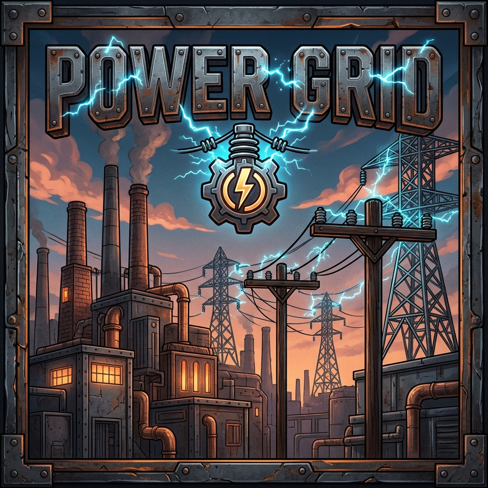

# CurseForge Upload Template & Metadata Guide: Power Grid

This document contains everything needed to publish and update **Power Grid** on CurseForge. You can copy-paste each section directly into the CurseForge Project Creation and File Upload forms.

---

## 1. CurseForge Project Submission Fields

### Project Name
`Power Grid`

### Short Summary / Tagline (Max 255 characters)
> Heavy industrial electricity distribution, overhead power poles, high-voltage transmission lines, substations, and multiblock power plants for modern Minecraft!

### Primary Category
- **Technology**

### Secondary Categories
- **Energy, Fluid, and Item Transport**
- **Processing**
- **Automation**

---

## 2. Project Description (Markdown / Rich Text)
*(Copy everything below this line into the "Description" box on CurseForge)*

---

# ⚡ Power Grid
**Heavy Overhead Electricity Distribution • High-Voltage Catenary Wires • Substations • 3x3x3 Multiblock Power Plants**

*Built natively for Minecraft 26.3 on NeoForge.*

---

## 🔌 Overview
**Power Grid** brings authentic electrical engineering back to Minecraft, deeply inspired by the beloved mechanics of *Immersive Engineering*. Say goodbye to invisible magical power cables buried underground — **Power Grid** requires you to plan, run, and maintain real overhead transmission lines across poles, towers, substations, and factories!

From running early copper Low-Voltage lines to your first workshop machines, to stepping up power with Substation Transformers and stringing heavy steel-core High-Voltage cables across entire mountain ranges to a massive 3x3x3 Multiblock Power Plant, Power Grid makes power transmission visually spectacular and engineeringly rewarding.

---

## ⚡ Core Features

### 1. Three-Tier Voltage Grid Architecture
- **Low Voltage (LV)**: 400 FE/t throughput, 16-block maximum span. Crafted from copper. Ideal for local workshops, lighting, and standalone machines.
- **Medium Voltage (MV)**: 2,048 FE/t throughput, 32-block maximum span. Crafted from electrum. Perfect for factory sub-mains and midgame industrial machinery.
- **High Voltage (HV)**: 16,384 FE/t throughput, 64-block maximum span. Heavy steel-core cables engineered for long-distance cross-country grid transmission.

### 2. Distance Resistance & Transmission Losses
- Just like real-world power grids, longer wire spans encounter electrical resistance.
- Low voltage suffers a 2.0% loss per block, making regional runs inefficient.
- High voltage lines feature only 0.5% loss per block, incentivizing engineers to construct realistic regional substations with step-up transformers!

### 3. Utility Poles & Transmission Towers
- **Treated Wood Utility Poles**: Authentic stackable wooden utility poles that blend seamlessly into countryside and town builds.
- **Steel Truss Lattice Towers**: Massive, blast-resistant high-voltage transmission towers for overland cable runs.
- **Pole Crossarms**: Horizontal timber crossarms mounted directly on poles to hold multiple wire connectors and relays.

### 4. Connectors, Relays, & Substation Gear
- **Wire Connectors**: Placed directly on machines, batteries, or generators. Automatically interfaces with NeoForge's standard `Capabilities.Energy.BLOCK` to push or pull line energy.
- **Wire Relays**: High-density pass-through insulators designed to turn corners and route branches without tapping into a block's internal buffer.
- **Substation Transformers**: High-efficiency (98%) step-up and step-down transformers connecting LV ⇄ MV and MV ⇄ HV networks.
- **In-Line Breaker Switches**: Heavy knife switches that cut power to entire branches manually or automatically when triggered by Redstone.
- **Heavy Accumulator Banks**: Industrial multi-cell capacitor storage units buffering up to **4,000,000 FE** each with rapid charge/discharge capabilities.

### 5. Multiblock Heavy Power Plant (3x3x3)
- Construct a true heavy industrial power plant using **Generator Casings**, **Alternator Coils**, **Turbine Rotors**, and **Industrial Exhaust Stacks**.
- Strike the front controller with the **Grid Engineer's Hammer** to assemble the multiblock.
- Produces **4,096 FE/t** of continuous industrial electricity, complete with animated smoke plumes and realistic mechanical hums!

### 6. Specialized Engineering Tools
- **Wire Coils (LV, MV, HV)**: Right-click the starting terminal, then right-click the destination terminal to string physical catenary wires.
- **Grid Voltmeter**: Live diagnostic multimeter reporting stored FE, throughput, voltage tier, and all connected terminal coordinates.
- **Grid Engineer's Hammer**: Validates and commissions multiblock power plants and rotates directional grid gear.
- **Insulated Wire Cutters**: Safely and cleanly disconnects all attached wire lines from any connector or relay.

---

## 🛠️ Mod Compatibility & Integration
- **Universal Forge Energy (FE)**: Built natively on NeoForge's Transfer API. Fully compatible with any mod supporting standard FE capabilities (`Capabilities.Energy.BLOCK`).
- **Industrial Refinery Synergy**: Connect an HV Wire Connector directly to refinery diesel generators or steam boilers to power your entire base from a central power station.
- **Logistics Mod Synergy**: Feed automation sorters, item pipes, and craft tables directly from overhead wire drop lines.

---

## 📜 License
Power Grid is released under the **MIT License**. You are free to include it in any modpack, server, or custom collection!
