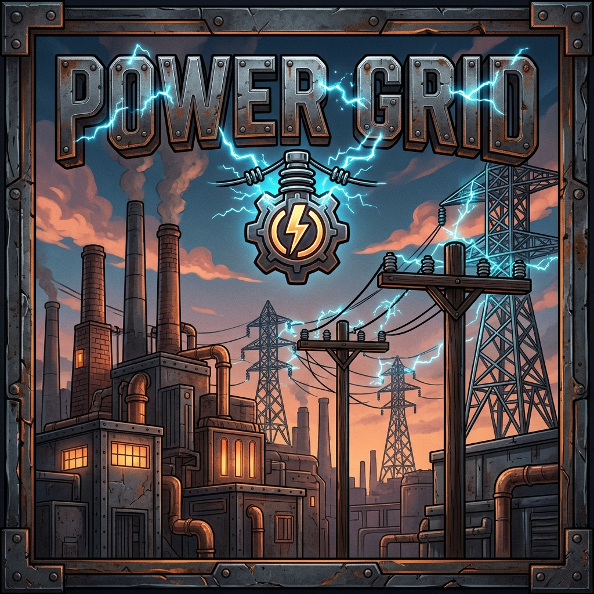

# Power Grid — Complete Engineering Wiki & Operator's Guide
*A comprehensive guide to high-voltage power distribution, overhead utility infrastructure, substations, and multiblock generation for Minecraft 26.3 NeoForge.*

---

## Table of Contents
1. [Overview & Philosophy](#1-overview--philosophy)
2. [Essential Engineering Tools](#2-essential-engineering-tools)
   - [Grid Engineer's Hammer](#grid-engineers-hammer)
   - [Grid Voltmeter](#grid-voltmeter)
   - [Insulated Wire Cutters](#insulated-wire-cutters)
   - [Overhead Wire Coils (LV, MV, HV)](#overhead-wire-coils-lv-mv-hv)
3. [The Three-Tier Transmission Grid](#3-the-three-tier-transmission-grid)
   - [Low Voltage (LV)](#low-voltage-lv)
   - [Medium Voltage (MV)](#medium-voltage-mv)
   - [High Voltage (HV)](#high-voltage-hv)
   - [Line Resistance & Transmission Loss](#line-resistance--transmission-loss)
4. [Indoor AWG Power Cables](#4-indoor-awg-power-cables)
   - [American Wire Gauge (AWG) Sizing](#american-wire-gauge-awg-sizing)
   - [Minimal Buffering & Network Flow](#minimal-buffering--network-flow)
   - [Tool Interactions & Side Toggling](#tool-interactions--side-toggling)
5. [Overhead Poles & Infrastructure](#5-overhead-poles--infrastructure)
   - [Treated Wood Utility Poles](#treated-wood-utility-poles)
   - [Steel Truss Lattice Towers](#steel-truss-lattice-towers)
   - [Pole Crossarms & Insulator Mounts](#pole-crossarms--insulator-mounts)
6. [Connectors, Relays, & Substations](#6-connectors-relays--substations)
   - [Wire Connectors (Block Interface)](#wire-connectors-block-interface)
   - [Wire Relays (Pass-Through Routing)](#wire-relays-pass-through-routing)
   - [Substation Transformers (Step-Up / Step-Down)](#substation-transformers-step-up--step-down)
   - [High-Voltage Breaker Switches](#high-voltage-breaker-switches)
   - [Heavy Accumulator Banks](#heavy-accumulator-banks)
   - [HPS Street Lights](#hps-street-lights)
   - [Pole-Mounted HPS Street Lights](#pole-mounted-hps-street-lights)
   - [Wooden Water Wheels (Hydroelectric Generation)](#wooden-water-wheels-hydroelectric-generation)
   - [Windmill Rotors (Aerodynamic Wind Generation)](#windmill-rotors-aerodynamic-wind-generation)
   - [Solar Panel Arrays (Standard, Gold 2x, Diamond 5x)](#solar-panel-arrays-standard-gold-2x-diamond-5x)
   - [Work-Site & Architectural Illumination](#work-site--architectural-illumination)
7. [Comprehensive Recipe Codex](#7-comprehensive-recipe-codex)
8. [Cross-Mod Interoperability & Capabilities](#8-cross-mod-interoperability--capabilities)
9. [Frequently Asked Questions (FAQ) & Troubleshooting](#9-frequently-asked-questions-faq--troubleshooting)

---

## 1. Overview & Philosophy

In modern modded Minecraft, electricity has often been reduced to magic single-block cables hidden beneath flooring. **Power Grid** brings back the romance, realism, and spatial puzzle of genuine electrical infrastructure, deeply inspired by the golden standard set by *Immersive Engineering*.

- **Physical Overhead Lines**: Run catenary copper, electrum, and steel-core wires strung between utility poles, rooftops, and substation yards.
- **Voltage Tier Progression**: Power cannot simply jump arbitrary distances without consequences. Low voltages suffer high transmission loss, demanding step-up transformation to High Voltage (HV) for long-distance cross-country spans.
- **Industrial Transmission Focus**: Build authentic distribution networks with wooden utility poles, steel towers, crossarms, ceramic insulators, substation transformers, and high-voltage breaker switches.
- **Native NeoForge Transfer API**: Built from the ground up for **Minecraft 26.3** and **NeoForge 26.3.0.48-beta**, natively exposing standard `Capabilities.Energy.BLOCK` for zero-lag, instant compatibility with mods like *Industrial Refinery*, *Logistics*, and all Forge Energy (FE) machines.

---

## 2. Essential Engineering Tools

Before building an electrical network, an engineer must craft their diagnostic and installation kit.

### Grid Engineer's Hammer
The quintessential tool of the trade.
- **Block Orientation**: Right-click on directional grid components (transformers, crossarms, breakers, water wheels) to cycle their horizontal facing or axle axis clockwise.
- **Connector Mode**: Right-click a Wire Connector to cycle its input/output mode.
- **Cable Side Isolation**: Right-click any face or arm of an Indoor Power Cable to toggle that side connected/disconnected, allowing clean isolation and preventing unintended connections.
- **Durability**: Indestructible hand tool.

### Grid Voltmeter
A precision electronic multimeter for live grid diagnostics.
- Right-click any **Wire Connector** or **Wire Relay** to display:
  - Voltage rating (LV, MV, or HV)
  - Number of connected lines
  - Destination coordinates and span distance of each connected wire
- Right-click any **Indoor Power Cable** to display:
  - Wire gauge rating (18, 16, 14, or 12 AWG)
  - Transferred energy throughput this tick and maximum rated throughput
  - Internal energy buffer status
- Right-click any **Wooden Water Wheel** to display:
  - Kinetic status (Spinning vs Stopped)
  - Detected water drop height in blocks
  - Real-time FE/t energy generation rate
  - Internal buffer capacity and stored energy
- Right-click any **Battery / Accumulator / Machine** to inspect:
  - Stored Forge Energy (FE) and maximum buffer capacity

### Insulated Wire Cutters
High-leverage ceramic-insulated wire snips.
- Right-click any **Wire Connector** or **Wire Relay** to immediately sever all attached wire lines, dropping the consumed wire coils back into your hands or onto the ground.
- Right-click any **Indoor Power Cable** to instantly snip and collect the cable piece into your inventory with zero delay.

### Overhead Wire Coils (LV, MV, HV)
The lifeblood of the power grid.
- **How to String Wires**:
  1. Hold a wire coil in your main hand.
  2. Right-click on the first terminal (Connector, Relay, or Breaker). A subtle audio knot click confirms the starting node is anchored.
  3. Walk to your target destination terminal and right-click it.
  4. The wire line instantly attaches, playing a resonant metallic chime!
- **Canceling an Open Run**: Shift-right-click empty air or any non-terminal block with the coil to cancel the starting node anchor.

---

## 3. The Three-Tier Transmission Grid

Power Grid enforces three strict voltage tiers. Terminal blocks (connectors and relays) will **refuse** to connect to mismatched wire tiers unless routed through a **Substation Transformer**.

| Voltage Tier | Conductor Material | Max Throughput | Max Span Distance | Resistance Loss Rate | Recommended Application |
| :--- | :--- | :--- | :--- | :--- | :--- |
| **LV (Low Voltage)** | Annealed Copper | **400 FE/t** | **16 blocks** | 2.0% per block | Workshops, early machinery, indoor lighting |
| **MV (Medium Voltage)** | Electrum (Au-Ag) | **2,048 FE/t** | **32 blocks** | 1.0% per block | Factory sub-mains, industrial smelters |
| **HV (High Voltage)** | Steel-Core Aluminum | **16,384 FE/t** | **64 blocks** | 0.5% per block | Cross-country overland grids, heavy industrial transmission |

### Line Resistance & Transmission Loss
Long overhead spans naturally encounter physical electrical resistance. Short runs under the loss-free distance threshold operate at 100% transmission efficiency (0% loss). For longer runs exceeding the threshold, net energy delivered to the receiving node equals:

$$\text{Effective Distance} = \max\left(0, \text{Total Distance} - \text{Loss-Free Distance}\right)$$
$$\text{Net Received} = \text{Transmitted FE} \times \left(1 - (\text{Effective Distance} \times \text{Loss Rate})\right)$$

- **Loss-Free Thresholds**: Short spans within substations, breaker switch drops, and nearby machines incur **0% loss** (defaults: LV $\le$ 8 blocks, MV $\le$ 16 blocks, HV $\le$ 24 blocks).
- **Fully Configurable (`config/powergrid.toml`)**:
  - Distance thresholds (`lvLossFreeDistance`, `mvLossFreeDistance`, `hvLossFreeDistance`).
  - Loss rates (`lvLossPerBlock`, `mvLossPerBlock`, `hvLossPerBlock`) default to `0.0` (0% loss) for initial testing and baseline stability, with documented intended production balance values (LV: 0.02, MV: 0.01, HV: 0.005).

---

## 4. Indoor AWG Power Cables

While overhead utility wires carry high voltages across long outdoor distances, **Indoor AWG Power Cables** provide clean, direct machine-to-machine power distribution inside workshops, substations, and industrial manufacturing plants.

### American Wire Gauge (AWG) Sizing
Following standard electrical engineering conventions, lower AWG numbers denote thicker conductors and higher energy transfer capacities:

| Cable Gauge | Core Metal Strand | Max Throughput | Internal Buffer | Recommended Use Case |
| :--- | :--- | :--- | :--- | :--- |
| **18 AWG** | Annealed Copper Strand | **128 FE/t** | **128 FE** | Low-power automation, lighting, sorting hubs |
| **16 AWG** | Refined Iron Strand | **512 FE/t** | **512 FE** | Standard workshop machinery, intermediate processing |
| **14 AWG** | High-Tensile Steel Strand | **2,048 FE/t** | **2,048 FE** | Heavy industrial factories, high-speed smelters |
| **12 AWG** | Electrum / Gold Strand | **8,192 FE/t** | **8,192 FE** | Main indoor feeder buses, substation drop interconnects |

### Minimal Buffering & Network Flow
- **Instant Flow Routing**: Cables act as pure electrical conductors rather than giant energy storage batteries. Energy inserted into any cable is routed along connected cable segments via breadth-first search (`CableNetworkRouter`) and pushed directly into connected machines during the same tick. If no machines demand power, insertion returns 0, allowing generators to safely idle in standby.
- **Battery Bank & Storage Protection**: Accumulator banks connected to a cable bus power machines without discharging into adjacent or networked accumulators, preventing parasitic power draw and endless battery-to-battery sloshing loops.
- **Bottleneck Preservation**: If you run a high-gauge (thin) cable between lower-gauge (thick) cables, the throughput across that path is naturally throttled to the narrowest cable's rated capacity, preserving realistic electrical physics without artificial loss.
- **Waterloggable**: Fully waterloggable blocks for safe routing through aquatic facilities or industrial basements.

### Tool Interactions & Side Toggling
- **Side Isolation**: Right-click any face or arm of a cable with the **Grid Engineer's Hammer** to disconnect or reconnect that specific face. Disconnected sides render as open air gaps and will not connect to adjacent machines or cables.
- **Fast Dismantling**: Right-click any cable with **Insulated Wire Cutters** to instantly dismantle it directly into your inventory.
- **Diagnostics**: Right-click any cable with the **Grid Voltmeter** to inspect its current throughput, gauge rating, and internal buffer.
- **Refinery Pipe Facade Support**: Fully compatible with pipe facades from the *Industrial Refinery* mod (both Solid Panels `refinery:pipe_facade` and Pass-Through Frames `refinery:pipe_facade_hole`) across all 4 AWG cable sizes (12, 14, 16, and 18 AWG).
  - **Attach & Swap**: Right-click any cable face with a facade to attach it. Right-clicking with a different facade cleanly swaps it and returns the old facade to your inventory.
  - **Wall Concealment**: Solid facades cover cable faces flush with adjacent walls, floors, and ceilings; hollow frames cleanly frame cable arms passing through wall penetrations.
  - **Intuitive Removal**: Sneak-Right-Click (Shift + Right-Click) with an empty hand, the **Grid Engineer's Hammer**, or a **Refinery Wrench** to pop the facade off. Breaking the cable block also drops all attached facades.
  - **Wrench Support**: Right-clicking a cable with a Refinery Wrench toggles face connections identically to the Engineer's Hammer.
  - *(Industrial Refinery is completely optional; Power Grid runs with zero hard dependencies.)*

---

## 5. Overhead Poles & Infrastructure

### Treated Wood Utility Poles
- Authentic **8-sided cylindrical wooden telephone poles** treated with deep creosote oil.
- Features dual galvanized steel reinforcement collars, alternating iron climbing rungs (spikes), and an end-grain top weather-protection cap.
- **Auto-Stacking**: Right-clicking any section of an existing pole with a pole item in hand automatically climbs to the top of the column and places the new pole, making tall utility pole construction fast and safe.

### Steel Truss Lattice Towers
- Heavy industrial galvanized steel truss columns designed for high-voltage transmission lines.
- Features 4 corner angle-iron posts, diagonal cross-lacing struts, and heavy gusset plates.
- **Tower Auto-Stacking**: Right-clicking any tower block with another truss pole in hand automatically stacks the tower upwards.
- Extremely blast-resistant and weather-hardened.

### Pole Crossarms & Insulator Mounts
- **Modular Rounded Timber Crossarm**: A rounded 6x6 horizontal creosote timber beam designed to attach directly to telephone poles.
- **Intelligent Side & Top Pole Attachment**:
  - **Side-Mount**: When placed against the side of a `TreatedWoodPoleBlock`, timber beams reach directly to the pole surface with heavy wrap-around forged steel collar straps and diagonal support gussets with zero air gap.
  - **Top-Mount (Flat Cap)**: When placed directly on top of a pole, it sits flat on the pole top with a heavy galvanized steel saddle plate, downward pole collar clasps, vertical riser column, and diagonal timber beam braces.
- **Horizontal Expansion**: Seamlessly connects to adjacent crossarms on either side, allowing builders to construct wide 3-block, 5-block, or multi-circuit high-voltage crossarm structures.
- **Auto-Extension**: Right-clicking an existing crossarm with a crossarm item automatically places the next segment extending horizontally outward.
- **Flush Insulator Mounting**: Top beam surface is positioned at Y=16.0 so Wire Relays and Connectors sit flush on top with zero gap.

---

## 6. Connectors, Relays, & Substations

### Visual Quality & 3D Element Models
- **32x32 High-Fidelity Default**: All blocks and items feature handcrafted 32x32 pixel art textures with creosote grain, metallic specular highlights, and glazed ceramic sheens.
- **1024x1024 Ultra-HD Resource Pack**: Includes a dedicated `(v1.0) 1024x Power Grid.zip` resource pack featuring photorealistic ultra-high-definition textures for all grid equipment.
- **Full 3D Element Geometry & Precision Alignment**:
  - **Crossarm-End Alignment**: When mounted on the end face of a horizontal crossarm, connectors and relays automatically center along the crossarm's beam axis ($Y=13.0$), eliminating any vertical sagging or drooping below the wood beam.
  - **Pole & Crossarm Standoff Brackets**: When placed on the side of a round wooden pole or side of a crossarm, heavy structural steel standoff channel brackets extend 5px backwards across the block boundary to clasp the timber flush, eliminating floating gaps.
  - **Flush Surface Mounting**: Mounted flush on full blocks, ceilings, and directly on top of poles and crossarm beams.

### Wire Connectors (Block Interface)
- Mounted on the face of any machine, generator, or battery.
- **Directional Energy Link**: The rear face of the connector automatically searches the block it is attached to for standard NeoForge energy capabilities (`Capabilities.Energy.BLOCK`).
- **Tri-State Operational Modes**:
  - **AUTO (Auto-Sensing)**: Automatically draws from generators and supplies consumers. When attached to energy storage (Heavy Accumulators), it charges from available grid producers and discharges into active consumers, but will never transfer to other storage nodes in `AUTO` mode, eliminating parasitic drain and oscillation.
  - **INPUT (From Machine to Grid)**: Forces the connector to strictly extract power from the attached machine/battery and push it into the wire network.
  - **OUTPUT (From Grid to Machine)**: Forces the connector to strictly receive power from the wire network and deliver it into the attached machine/battery.
- Supports up to **4 simultaneous wire attachments**.

### Wire Relays (Pass-Through Routing)
- Multi-tier ceramic standoff insulators that **do not** interact with the block behind them:
  - **LV Relay**: Single porcelain ribbed bell with copper conductor clamp.
  - **MV Relay**: Dual-tiered terracotta porcelain bells with electrum saddle clamp.
  - **HV Relay**: Heavy three-tiered slate-blue porcelain suspension bells with heavy steel suspension clamp.
- Designed strictly to bridge spans, make sharp 90-degree turns around buildings, or distribute branches across open yards.
- High-capacity terminals supporting up to **8 simultaneous wire attachments**.

### Substation Transformers (Step-Up / Step-Down)
- The heart of any regional electrical grid.
- Allows seamless conversion between adjacent tiers:
  - **LV to MV** (and vice versa)
  - **MV to HV** (and vice versa)
- Built with internal laminated silicon-steel cores providing a **98% power conversion efficiency**.
- Equipped with a 64,000 FE high-speed balancing buffer supporting up to **16,384 FE/t** throughput.

### Heavy-Duty Safety Disconnect Switches (Breaker Switch)
- Authentic **wall-mounted industrial disconnect safety switch** modeled after commercial Siemens/Square-D heavy-duty enclosures.
- **3D Sheet Metal Cabinet**: Slim wall-mounted enclosure featuring a beveled hinged front door, stamped raised panel, left barrel hinges, padlockable latch clasp, and top/bottom threaded conduit hubs.
- **Animated Red Disconnect Lever**: Features a side-mounted steel pivot arm with a bright red molded safety grip handle. When toggled, the handle physically snaps between **UP** (Circuit Closed / Power ON) and **DOWN** (Circuit Open / Power OFF).
- **Manual & Redstone Operation**: Right-click to throw the disconnect switch with a resonant industrial metallic clack, or connect a redstone signal to automate circuit cutoffs during grid surges or emergencies.
- Acts as a switchable gate between two connected wire nodes.

### Heavy Accumulator Banks
- Massive industrial capacitor banks storing up to **4,000,000 FE** per unit.
- Supports blazing **16,384 FE/t** simultaneous charge and discharge rates.
- Automatically pushes energy to connected low-buffer machines and wire connectors.

### Pole-Mounted HPS Street Lights
- Authentic utility pole attachment fixture modeled after classic North American municipal cobrahead street lights mounted to wooden or steel utility poles.
- **Overhead Wire Powered Only**: Implements `IWireNode` with a dedicated ceramic insulator terminal atop the mounting clamp. Accepts LV, MV, and HV wire lines directly from overhead poles (supports up to 2 concurrent wire connections for line drops and daisy-chaining). Does not accept power from indoor cables.
- **Dual-Tier Illumination**: Emits warm standby glow (Level 7) when unpowered; boosts to full brightness (Level 15) when energized with 5 FE/t from the overhead line.
- **Dusk-to-Dawn Photocell Sensor**: Sneak-Right-Click with Engineer's Hammer toggles Dusk-to-Dawn sensor mode (energizes only during dark hours/storms) vs. 24/7 Always Active mode. Normal right-click rotates orientation.

### HPS Street Lights
- Authentic 4-block municipal street lights modeled after classic North American cobrahead fixtures.
- **Architectural Construction**: Features a square concrete footing foundation with steel anchor bolts, slender galvanized metal pole column, and sweeping davit mast arm with a teardrop HPS luminaire.
- **Dual-Tier Illumination**:
  - **Standby Mode (Unpowered)**: Emits warm amber standby illumination (Light Level 7, ~7 block radius) upon placement without needing external power.
  - **Energized Mode (Powered)**: Emits brilliant high brightness (Light Level 15, full 15-block radius) when energized with 5 FE/t supplied to the concrete base.
- **Base Energy Capability**: The concrete footing base implements `Capabilities.Energy.BLOCK` (1,000 FE buffer, 32 FE/t max receive), connecting directly to indoor AWG power cables, wire connectors, and energy sources.
- **Dusk-to-Dawn Photocell**: Sneak-Right-Click with the Grid Engineer's Hammer toggles between Automatic Dusk-to-Dawn photocell sensor mode (lights up during night/storms) and 24/7 Always Active mode. Normal right-click rotates the fixture.
- **Coordinated Assembly Placement**: Placing 1 item deploys all 4 blocks (`BASE`, `POLE_LOWER`, `POLE_UPPER`, `HEAD`). Breaking any section cleanly deconstructs the whole fixture.

### Wooden Water Wheels (Hydroelectric Generation)
- **Kinetic Hydroelectric Generator (3x3x1)**: Authentic 3-block diameter, 1-block wide wooden water wheel multiblock generating green renewable energy from natural water currents.
- **Height-Drop Energy Generation**:
  - Generates **10 FE/tick per vertical height level of flowing water drop** that the wheel is placed in.
  - 1-block drop = 10 FE/t, 2-block drop = 20 FE/t, 3-block drop = 30 FE/t, with waterfall drops extending up to 50 FE/t (configurable up to 32 levels via `waterWheelMaxDrop`).
- **Torque & Flow Requirement**:
  - To spin and generate torque, the wheel **must be placed in flowing water** (`!fluidState.isSource()` or falling/directional flow vectors).
  - Still standing water produces zero torque, does not spin the wheel, and produces 0 FE/t.
- **Center Axle Energy Hub**:
  - The central axle hub implements standard `Capabilities.Energy.BLOCK`, directly outputting stored FE into adjacent substation transformers, heavy accumulators, AWG cables, or wire connectors.
- **Axle Stacking & Seamless Power Transfer**:
  - Water wheels placed adjacent to each other along their axle axis automatically form a continuous drive shaft.
  - Energy generated by all wheels across the stack pools and transfers smoothly through the entire axle line to the terminal wheel(s), which push the accumulated power directly into downstream transformers or battery banks.
- **Zero-Flicker Monolithic 3D Geometry**:
  - Built following high-fidelity Monolithic 3D standards with a custom 256x256 procedural texture atlas.
  - Includes a heavy square timber axle, dual iron hub plates with hex bolts, 8 radial timber spokes, dual outer rim rings, and 12 angled water buckets.
  - Features 0.5px half-texel UV inset margins, PoseStack normal transformations, and immediate depth-buffer writes for 100% flicker-free rendering.
- **Intuitive Placement & Waterlogging**:
  - Checks 3x3 clearance upon placement. Placing against an existing wheel automatically aligns axle orientation.
  - Fully supports `SimpleWaterloggedBlock` so wheels can be placed directly in rivers and flumes without wiping out water sources.
  - Breaking any part deconstructs the 3x3 assembly and drops a single `Wooden Water Wheel` item.
  - Right-click with the Grid Engineer's Hammer rotates the axle axis by 90 degrees; right-click with the Grid Voltmeter inspects live telemetry.

### Grid Engineer's Field Manual (In-Game Guidebook)
- **Interactive Engineering Manual**: Right-click to open an authentic industrial guidebook matching the styling of the *Refinery* and *Track and Trains* manuals, complete with riveted steel bezels, brass corner brackets, and dark slate binder aesthetics.
- **7 Dedicated Topic Categories**: Fast categorical navigation across *All Contents*, *Power Generation*, *Overhead Grid*, *Substation & Storage*, *Indoor Wiring*, *Illumination Suite*, and *Tools & Materials*.
- **Multiblock Layout & Blueprint Visualizers**: Full 2D top-down and front-facing layer visualizers with symbol legends, relative coordinates, and Bill of Materials for `Wooden Water Wheel` and `Windmill Rotor` multiblocks.
- **Interactive Recipe Cards & Engineering Specs**: Visual recipe layouts showing inputs $\rightarrow$ arrow $\rightarrow$ outputs with item tooltips, throughput limits, voltage safety rules, and clearance requirements.

### Windmill Rotors (Aerodynamic Wind Generation)
- **Kinetic Wind Turbine Multiblock (3x3x1)**: Authentic 3-block diameter, 1-block wide industrial windmill rotor harvesting kinetic energy from open atmospheric air currents.
- **Ground Clearance Requirement (3 Air Blocks)**:
  - Requires **at least 3 air blocks of open vertical clearance** directly beneath the bottom edge of the rotor (`center.below(2..4)`) to catch laminar wind flow.
  - If ground, trees, or structures are within 3 blocks underneath the rotor, it enters a stopped stall state and produces **0 FE/t**.
- **Altitude-Based Power Scaling**:
  - The higher above the ground the windmill rotor is placed, the faster the wind currents and the more energy it generates!
  - Generates **10 FE/tick** at minimum clearance (3 air blocks), scaling by **+2 FE/tick for each additional block of open air clearance** beneath it, up to a maximum ceiling of **64 FE/tick** (reached at 30+ blocks above ground).
  - Weather Wind Boost: Automatically gains **+20% generation during rain** and a **+50% storm surge generation during thunderstorms**.
- **Central Axle Power Hub & Axle Stacking**:
  - Central axle hub natively exposes standard `Capabilities.Energy.BLOCK`, directly outputting Forge Energy to adjacent substation transformers, heavy accumulators, AWG cables, or wire connectors.
  - Rotors placed side-by-side along their axle axis automatically form a unified wind farm drive shaft line, pooling power cleanly across the entire stack to terminal rotors that push into downstream transformers or batteries without internal sloshing.
- **Monolithic 3D Zero-Flicker Model & Smooth Continuous Rotation**:
  - Custom 256x256 procedural texture atlas with 0.5px UV inset margin padding, PoseStack normal transformations, and pre-allocated geometry for flicker-free rendering.
  - Continuously interpolates rotation speed based on active generation, game time, and partial ticks (`(animTicks * spinSpeed) % 360°`), providing ultra-smooth 60/120/144+ FPS motion.
  - Features a heavy banded timber axle, cast iron hub flange with hex bolts, brass bearing nose cap, 4 heavy structural spars, steel brackets, angled aerodynamic wood/canvas sail slats, and 4 diagonal bracing struts.
- **Placement & Hammer Alignment**:
  - Checks 3x3 clearance upon placement. Placing against an existing rotor automatically aligns the axle orientation for effortless stacking.
  - Right-clicking with the Grid Engineer's Hammer rotates the axle axis by 90 degrees if clearance permits.
  - Right-clicking with the Grid Voltmeter inspects live status: spinning state, air clearance below, generation rate, and buffer levels.

### Solar Panel Arrays (Standard, Gold 2x, Diamond 5x)
- **Compact Photovoltaic Monoliths (1x1x7px)**: Modern, low-profile solar generation panels with under-deck inverter enclosures, cooling heatsink fins, and corner rubber isolation feet.
- **Three Progressive Generation Tiers**:
  - **Standard Solar Panel (`powergrid:solar_panel`)**: Baseline photovoltaic generator crafted with iron. Produces **1 FE/tick** in daylight with a **10,000 FE** internal buffer and 100 FE/t export rate.
  - **Gold Solar Panel (`powergrid:gold_solar_panel`)**: Advanced gold-doped photovoltaic generator crafted with Gold Ingots. Produces **2 FE/tick (2x baseline)** in daylight with a **20,000 FE** internal buffer and 200 FE/t export rate. Warm golden-amber cells with polished brass/gold bezel.
  - **Diamond Solar Panel (`powergrid:diamond_solar_panel`)**: Elite diamond-doped photovoltaic generator crafted with Diamonds. Produces **5 FE/tick (5x baseline)** in daylight with a **50,000 FE** internal buffer and 500 FE/t export rate. Brilliant cyan crystal facets with sleek platinum bezel.
- **Connected Multi-Block Array Architecture**:
  - Placing identical solar panels side-by-side automatically merges their outer bezels, extending continuous 3D raised silver busbars across cells and forming shared under-deck structural trusses.
  - Automatically balances stored energy across connected panel arrays to prevent localized bottlenecks.
- **Omnidirectional Power Export**:
  - Central bottom port and all four side faces implement standard `Capabilities.Energy.BLOCK`, directly feeding adjacent substation transformers, heavy accumulators, AWG power cables, or wire connectors. The top photovoltaic glass surface is sealed.
- **Live Diagnostics**:
  - Right-click any panel (or use the Grid Voltmeter) to inspect tier name, real-time daylight/idle status, active FE/t generation, and internal buffer levels.

### Work-Site & Architectural Illumination
- **Tripod Work Light (`powergrid:tripod_work_light`)**:
  - 2-block-tall industrial job-site dual halogen floodlight mounted on a heavy safety-yellow telescoping tripod stand with non-slip rubber feet.
  - Right-click anywhere on the stand or light heads to toggle on/off with tactile switch audio (Light Level 15).
- **Ceiling Shop Light (`powergrid:ceiling_shop_light`)**:
  - 2-block-long commercial dual-tube fluorescent fixture with powder-coated sheet metal housing and electrical punch-outs.
  - Mounts flush to the underside of solid ceilings; right-click to toggle tubes on/off (Light Level 15).
- **Wall Floodlight (`powergrid:wall_floodlight`)**:
  - Architectural outdoor security floodlight with dark bronze base, dual angled conical floodlight heads, textured lenses, and central PIR motion-sensor dome styling.
  - Mounts flush to wall surfaces; right-click to toggle on/off (Light Level 15).
- **Carriage Lantern (`powergrid:carriage_lantern`)**:
  - Traditional coach and carriage exterior wall lantern featuring an ornate cast-iron bracket, pagoda hood, top finial, clear glass enclosure, and glowing 3D incandescent filament bulb.
  - Mounts directly to wall surfaces; right-click to toggle on/off (Warm Light Level 15).

---

## 7. Comprehensive Recipe Codex

| Item / Block | Pattern Layout | Ingredients | Output |
| :--- | :--- | :--- | :--- |
| **Grid Engineer's Field Manual** | Book + Copper Ingot (Shapeless) | 1x Book, 1x Copper Ingot (or Copper Wire Strand) | 1x Field Manual |
| **Grid Engineer's Hammer** | `  I` / ` S ` / `S  ` | 1x Iron Ingot (`I`), 2x Stick (`S`) | 1x Engineer's Hammer |
| **Grid Voltmeter** | ` C ` / `RGR` / ` I ` | 1x Copper (`C`), 2x Redstone (`R`), 1x Glass Pane (`G`), 1x Iron Ingot (`I`) | 1x Voltmeter |
| **Insulated Wire Cutters** | `I I` / ` S ` / `S S` | 2x Iron Ingot (`I`), 3x Stick (`S`) | 1x Wire Cutters |
| **Treated Wood Planks**   | `PPP` / `PCP` / `PPP` | 8x Planks (`P`), 1x Coal / Charcoal (`C`) | 8x Treated Wood Planks |
| **Copper Wire Strand**   | `CCC` (or 1x Shapeless) | 3x Copper Ingot (`C`) (or 1x $\rightarrow$ 2) | 6x Copper Wire Strand |
| **Electrum Wire Strand** | `GC` (Shapeless) | 1x Gold Ingot (`G`), 1x Copper Ingot (`C`) | 4x Electrum Wire Strand |
| **Reinforced Steel Strand** | Blasting / Smelting / Crafting | 1x Iron Ingot (Furnace/Blast) or 3x Iron + 1x Coal | 1x (or 4x) Steel Strand |
| **Ceramic Insulator**    | ` C ` / ` T ` / ` I ` | 1x Clay (`C`), 1x Terracotta (`T`), 1x Iron Ingot (`I`) | 4x Ceramic Insulator |
| **18 AWG Power Cable**   | `KKK` / `CCC` / `KKK` | 3x Copper Ingot or Wire (`C`), 6x Kelp / Rubber (`K`) | 8x 18 AWG Cable |
| **16 AWG Power Cable**   | `KKK` / `III` / `KKK` | 3x Iron Ingot (`I`), 6x Kelp / Rubber (`K`) | 8x 16 AWG Cable |
| **14 AWG Power Cable**   | `KKK` / `SSS` / `KKK` | 3x Steel Strand or Steel Ingot (`S`), 6x Kelp / Rubber (`K`) | 8x 14 AWG Cable |
| **12 AWG Power Cable**   | `KKK` / `GGG` / `KKK` | 3x Gold Ingot or Electrum Wire (`G`), 6x Kelp / Rubber (`K`) | 8x 12 AWG Cable |
| **LV Copper Wire Coil**  | ` C ` / `CSC` / ` C ` | 4x Copper Ingot or Wire (`C`), 1x Stick (`S`) | 4x LV Wire Coil |
| **MV Electrum Wire Coil**| ` G ` / `CSC` / ` G ` | 2x Gold Ingot (`G`), 2x Copper Ingot (`C`) (or 4x Electrum Wire), 1x Stick (`S`) | 4x MV Wire Coil |
| **HV Steel-Core Coil**   | ` I ` / `ISI` / ` I ` | 4x Iron Ingot or Steel Strand (`I`), 1x Stick (`S`) | 4x HV Cable Coil |
| **LV Wire Connector**    | ` C ` / ` C ` / ` I ` | 2x Copper Ingot (`C`), 1x Ceramic Insulator (`I`) | 4x LV Wire Connector |
| **MV Wire Connector**    | ` G ` / ` G ` / ` I ` | 2x Gold Ingot (`G`), 1x Ceramic Insulator (`I`) | 4x MV Wire Connector |
| **HV Wire Connector**    | ` S ` / ` S ` / ` I ` | 2x Iron Ingot (`S`), 1x Ceramic Insulator (`I`) | 4x HV Wire Connector |
| **LV Wire Relay**        | ` I ` / ` I ` | 2x Ceramic Insulator (`I`) | 4x LV Wire Relay |
| **MV Wire Relay**        | ` I ` / ` G ` / ` I ` | 2x Ceramic Insulator (`I`), 1x Gold Ingot (`G`) | 4x MV Wire Relay |
| **HV Wire Relay**        | ` I ` / ` S ` / ` I ` | 2x Ceramic Insulator (`I`), 1x Iron Ingot (`S`) | 4x HV Wire Relay |
| **Treated Wood Pole**    | ` W ` / ` W ` / ` W ` | 3x Treated Wood or Spruce Planks (`W`) | 6x Wood Poles |
| **Pole Crossarm**        | `WWW` / ` S ` / `   ` | 3x Treated Wood or Spruce Planks (`W`), 1x Stick (`S`) | 2x Crossarms |
| **Steel Truss Tower**    | ` I ` / `ISI` / ` I ` | 4x Iron Bars (`I`), 1x Iron Ingot (`S`) | 6x Steel Truss Towers |
| **Substation Transformer**| `ICI` / `CRC` / `ICI` | 4x Iron Ingot (`I`), 4x Copper Ingot (`C`), 1x Redstone (`R`) | 1x Substation Transformer |
| **Heavy Accumulator**    | `III` / `RBR` / `III` | 6x Iron Ingot (`I`), 2x Redstone Block (`R`), 1x Copper Block (`B`) | 1x Heavy Accumulator |
| **Safety Breaker Switch**| `III` / `ILI` / `IRI` | 7x Iron Ingot (`I`), 1x Lever (`L`), 1x Redstone (`R`) | 1x Breaker Switch |
| **Wooden Water Wheel**   | `WTW` / `TIT` / `WTW` | 4x Treated Wood Planks (`W`), 4x Planks (`T`), 1x Iron Ingot (`I`) | 1x Wooden Water Wheel |
| **Windmill Rotor**       | `CWC` / `WIW` / `CWC` | 4x Wool (`C`), 4x Treated Wood Planks (`W`), 1x Iron Ingot (`I`) | 1x Windmill Rotor |
| **Street Light**         | ` GI` / ` I ` / `CRC` | 1x Glowstone (`G`), 2x Iron (`I`), 2x Smooth Stone (`C`), 1x Redstone (`R`) | 1x Street Light |
| **Standard Solar Panel** | `GGG` / `LQL` / `IRI` | 3x Glass (`G`), 2x Lapis (`L`), 1x Quartz (`Q`), 2x Iron (`I`), 1x Redstone (`R`) | 1x Solar Panel |
| **Gold Solar Panel**     | `GGG` / `LQL` / `URU` | 3x Glass (`G`), 2x Lapis (`L`), 1x Quartz (`Q`), 2x Gold Ingot (`U`), 1x Redstone (`R`) | 1x Gold Solar Panel |
| **Gold Solar (Upgrade)** | ` G ` / `GSG` / ` G ` | 4x Gold Ingot (`G`), 1x Standard Solar Panel (`S`) | 1x Gold Solar Panel |
| **Diamond Solar Panel**  | `GGG` / `LQL` / `DRD` | 3x Glass (`G`), 2x Lapis (`L`), 1x Quartz (`Q`), 2x Diamond (`D`), 1x Redstone (`R`) | 1x Diamond Solar Panel |
| **Diamond Solar (Upgrade)**|` D ` / `DSD` / ` D `| 4x Diamond (`D`), 1x Gold Solar Panel (`S`) | 1x Diamond Solar Panel |
| **Tripod Work Light**    | `LGL` / ` Y ` / `I I` | 2x Redstone Lamp (`L`), 1x Glowstone (`G`), 1x Yellow Dye (`Y`), 2x Iron Ingot (`I`) | 1x Tripod Work Light |
| **Ceiling Shop Light**   | `III` / `GGG` / `R R` | 3x Iron Ingot (`I`), 3x Glowstone (`G`), 2x Redstone (`R`) | 2x Ceiling Shop Light |
| **Wall Floodlight**      | ` I ` / `LSL` / ` R ` | 1x Iron Ingot (`I`), 2x Redstone Lamp (`L`), 1x Quartz (`S`), 1x Redstone (`R`) | 1x Wall Floodlight |
| **Carriage Lantern**     | ` I ` / `GTG` / ` I ` | 2x Iron Ingot (`I`), 2x Glass Pane (`G`), 1x Torch (`T`) | 1x Carriage Lantern |

---

## 8. Cross-Mod Interoperability & Capabilities

Power Grid is built directly on NeoForge's official **Transfer API**:
- **Forge Energy Standard**: Any block registered with `Capabilities.Energy.BLOCK` can directly receive or supply power via `WireConnectorBlock` or **Indoor AWG Power Cables**.
- **Refinery Mod Synergy**:
  - Connect HV Wire Connectors or indoor AWG cables directly to *Industrial Refinery* Diesel Generators, Steam Turbines, or industrial machines to export or supply power seamlessly.
  - Conceal indoor AWG cables within walls and floors using *Industrial Refinery* Pipe Facades (Solid Panels and Hollow Pass-Through Frames) with full dynamic textures, lighting, and collision.
  - Use the Refinery Wrench to toggle cable connections or remove attached facades.
- **Logistics Mod Synergy**: Feed automation machinery, item pipes, and craft tables directly from indoor AWG cables or overhead drop lines.

---

## 9. Frequently Asked Questions (FAQ) & Troubleshooting

**Q: My wire won't attach between two connectors!**
> **A**: Verify that both terminals are of the exact same tier (e.g. LV Connector to LV Relay). Also check that the distance does not exceed the wire's maximum span (16 blocks for LV, 32 for MV, 64 for HV). Use your **Grid Voltmeter** to check line status.

**Q: Can players take shock damage from exposed wires?**
> **A**: High-voltage lines carry extreme currents! While LV lines are safe to touch, uninsulated HV transmission cables will deliver a nasty electrical shock if players brush against them without protective gear.

**Q: How do I remove a wire line?**
> **A**: Right-click the terminal with **Insulated Wire Cutters**. All connected coils will cleanly pop off and drop into your inventory.

**Q: My Wooden Water Wheel is placed in water but isn't spinning or generating power.**
> **A**: To generate torque and spin, the water wheel requires **flowing water** (currents, waterfalls, or flumes). Static standing source water will not turn the wheel. Ensure water is actively dropping or flowing past the wheel blades!

**Q: Why isn't my Windmill Rotor turning or generating FE?**
> **A**: The Windmill Rotor requires **at least 3 air blocks of open vertical clearance** directly beneath the rotor's bottom segment (`center.below(2..4)`). If placed too close to the ground, roofs, or vegetation, it stalls with 0 FE/t. Build it higher off the ground to increase wind velocity and FE output (up to 64 FE/t)!

**Q: Do Solar Panels work indoors or during thunderstorms?**
> **A**: Solar panels require clear access to daylight and direct sky exposure above them. During night or heavy dark weather, panels enter an idle standby state. Arrays placed together automatically balance energy and discharge power downwards or sideways into attached cables and machines.

---

## 📜 License
Power Grid is proudly open-source under the [MIT License](LICENSE).
